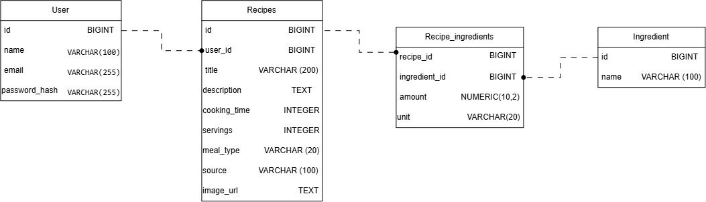

# Frontend

Веб-часть проекта **Family Recipes** — интерфейс в браузере для работы с семейными рецептами.  
Общается с общим backend по HTTP (REST API).

## Общее описание

Пользователь может зарегистрироваться, войти в аккаунт, просматривать свои рецепты, создавать новые и открывать карточку рецепта.  
Данные хранятся в PostgreSQL.

## Стек

- React
- TypeScript
- Vite

## Что реализовано

- Регистрация и вход (JWT)
- Сохранение сессии
- Выход из аккаунта
- Удаление аккаунта
- Главная страница со списком рецептов пользователя
- Создание рецепта (название, категория, время, порции, источник, ингредиенты, описание)
- Просмотр рецепта (режим чтения)

## Структура

- `src/pages` — экраны (Login, Register, Home, RecipeDetail)
- `src/components` — Navbar, ProfileMenu, RecipeCard (части UI)
- `src/api` — запросы к backend
- `src/context` — AuthContext (текущий пользователь и токен)

## Как запустить
# Frontend (веб-клиент)

Веб-часть проекта **Family Recipes** — интерфейс в браузере для работы с семейными рецептами.  
Общается с общим backend по HTTP (REST API).

## Общее описание

Пользователь может зарегистрироваться, войти в аккаунт, просматривать свои рецепты, создавать новые и открывать карточку рецепта.  
Данные хранятся не на клиенте, а в PostgreSQL через FastAPI.
Схема БД:



## Стек

- React
- TypeScript
- Vite
- CSS (модульные/общие стили приложения)

## Что реализовано

- Регистрация и вход (JWT)
- Сохранение сессии (токен в `localStorage`, `AuthContext`)
- Выход из аккаунта
- Удаление аккаунта
- Главная страница со списком рецептов **с сервера** (`GET /recipes`)
- Создание рецепта (название, категория, время, порции, источник, ингредиенты, описание)
- Просмотр рецепта (режим чтения)
- Базовая вёрстка: шапка, карточки, формы входа и рецепта

## Что нужно добавить

- Редактирование и удаление рецепта
- Поиск рецепта по имени и фильтр по категории
- Загрузка фото к рецепту
- Улучшение отображения рецепта

## Структура

- `src/pages` — экраны (Login, Register, Home, RecipeDetail)
- `src/components` — Navbar, ProfileMenu, RecipeCard
- `src/api` — запросы к backend
- `src/context` — AuthContext (текущий пользователь и токен)

## Как запустить

```bash
cd frontend
npm install
npm run dev
